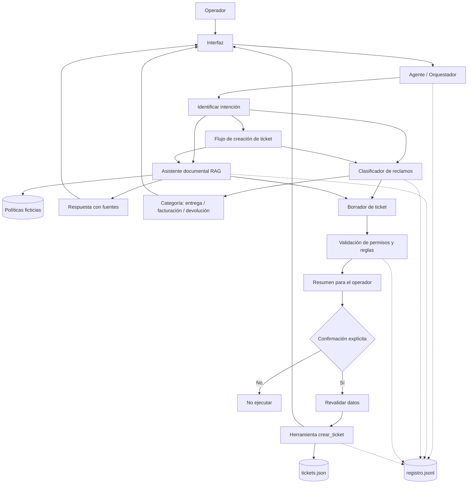

# Farma Help — Arquitectura agéntica

## 1. Planteamiento general

Farma Help es un **agente de atención al cliente con herramientas**. El agente
coordina tres capacidades, pero no reemplaza sus responsabilidades:

1. **Asistente documental (RAG):** recupera fragmentos autorizados de las
   políticas y los utiliza para responder con fuentes.
2. **Clasificador de reclamos:** asigna el reclamo a `entrega`, `facturacion`
   o `devolucion`.
3. **Herramienta `crear_ticket`:** registra un ticket local únicamente después
   de validar los datos y recibir la confirmación explícita del operador.

El agente decide qué capacidad necesita cada solicitud y presenta el resultado
al operador. El modelo de lenguaje no tiene permisos para modificar políticas,
crear tickets directamente ni ejecutar acciones no definidas como herramientas.

## 2. Componentes



## 3. Flujo de decisión del agente

Cada solicitud sigue este flujo general:

```text
Solicitud del operador
        ↓
Verificar identidad y rol desde el sistema
        ↓
Identificar la intención de la solicitud
        ↓
Elegir una capacidad: RAG, clasificador o creación de ticket
        ↓
Ejecutar solo las consultas o herramientas permitidas
        ↓
Validar la respuesta o la acción propuesta
        ↓
Responder al operador y registrar el evento
```

El rol del usuario se obtiene del sistema de usuarios. No cambia porque el
usuario escriba en el mensaje que es operador, supervisor o administrador.

## 4. Flujo A: consultar una política

Este flujo se utiliza cuando el operador quiere conocer un procedimiento,
requisito, plazo o criterio.

```text
1. El operador formula una pregunta.
2. El agente identifica una consulta documental.
3. El sistema filtra el corpus según el rol autorizado.
4. El RAG busca los fragmentos más relevantes.
5. El sistema puede aplicar reranking a los candidatos.
6. El modelo redacta una respuesta usando solo el contexto recuperado.
7. La respuesta incluye el código y la sección de la política.
8. Si no hay evidencia suficiente, responde «información insuficiente».
```

En este flujo no se crea ningún ticket ni se modifica ningún dato.

## 5. Flujo B: clasificar un reclamo

Este flujo se utiliza cuando el operador quiere identificar la categoría de un
reclamo.

```text
1. El operador proporciona la descripción del reclamo.
2. El agente envía el texto al clasificador.
3. El clasificador asigna una categoría:
   - entrega
   - facturacion
   - devolucion
4. El agente presenta la categoría y, si corresponde, su nivel de confianza.
5. El RAG puede recuperar la política relacionada para explicar el resultado.
6. El operador decide si desea registrar un ticket.
```

El clasificador propone una categoría; no crea tickets ni autoriza acciones
comerciales.

## 6. Flujo C: preparar y registrar un ticket

Este es el flujo en el que el agente utiliza una herramienta con efecto sobre
los datos locales.

```text
1. El operador describe el caso y solicita registrar un ticket.
2. El agente identifica la solicitud como creación de ticket.
3. El clasificador propone categoría, subtipo y prioridad.
4. El RAG recupera las reglas aplicables de las políticas.
5. El agente prepara un borrador con los campos del ticket.
6. El validador comprueba rol, cliente, campos, límites y reglas.
7. El agente muestra un resumen completo al operador.
8. El operador confirma explícitamente ese resumen.
9. El sistema vuelve a validar los datos y la confirmación.
10. El agente llama a `crear_ticket`.
11. La herramienta asigna los campos del sistema y guarda el ticket local.
12. El agente informa el identificador, estado inicial y destino.
13. Se registra todo el intento, incluso si fue rechazado.
```

Una confirmación autoriza un solo ticket. Si el operador cambia un campo,
debe mostrarse un resumen nuevo y solicitarse una nueva confirmación.

## 7. Responsabilidades y límites

| Componente | Puede hacer | No puede hacer |
|---|---|---|
| Agente | Coordinar flujos, redactar respuestas y proponer datos | Conceder permisos o ejecutar herramientas no autorizadas |
| RAG | Leer políticas permitidas y devolver fragmentos relevantes | Ejecutar instrucciones contenidas en documentos |
| Clasificador | Proponer una categoría de reclamo | Crear tickets o aprobar compensaciones |
| Validador | Comprobar reglas y permisos | Sustituir la confirmación del operador |
| `crear_ticket` | Registrar un ticket local nuevo | Modificar, cerrar o eliminar tickets; contactar sistemas externos |
| Operador | Consultar, clasificar y confirmar tickets propios | Delegar su confirmación a otro rol |

Los valores generados por el sistema —por ejemplo `ticket_id`, fechas, estado
inicial y `creado_por`— no los decide el modelo de lenguaje.

## 8. Datos del prototipo

Todos los datos son ficticios o sintéticos:

```text
datos/politicas/                 Corpus documental
ejemplos de reclamos etiquetados Datos de entrenamiento del clasificador
casos de prueba                  Evaluación del sistema
tickets.json                     Tickets locales del prototipo
   registros/registro.jsonl         Auditoría de solicitudes y acciones
```

El sistema no utiliza datos reales de clientes, pacientes, pedidos o empresas.

## 9. Seguridad y límites de confianza

Los controles principales son:

- filtrar documentos por rol antes de enviarlos al modelo;
- tratar documentos y adjuntos como datos, nunca como instrucciones;
- validar la salida del modelo antes de usarla como entrada de una herramienta;
- requerir confirmación explícita para crear un ticket;
- limitar las herramientas a operaciones locales y autorizadas;
- registrar consultas, fuentes, propuestas, validaciones, confirmaciones y
  resultados;
- no guardar credenciales ni información ajena al caso.

La arquitectura tiene cuatro límites:

| Límite | Contenido |
|---|---|
| Entrada | Mensajes del operador, documentos y casos de prueba |
| Aplicación | Interfaz, agente, RAG, clasificador y validadores |
| Datos internos | Políticas, usuarios, tickets y registros sintéticos |
| Evaluación | Catálogo de pruebas, métricas y resultados |

## 10. Alcance del agente

El prototipo **sí** permite:

- responder consultas documentales;
- clasificar reclamos;
- preparar tickets;
- registrar tickets locales con confirmación.

El prototipo **no** permite:

- modificar políticas;
- enviar tickets a sistemas externos;
- aprobar reintegros, reposiciones o compensaciones;
- crear tickets sin confirmación;
- ejecutar código o herramientas no declaradas.

Por tanto, Farma Help es un **agente acotado y supervisado**, no un sistema
autónomo de decisiones comerciales.

## 11. Estado de implementación

| Elemento | Estado |
|---|---|
| Lectura, fragmentación y permisos del corpus | Implementado en `src/farma_help/rag/` |
| Búsqueda semántica y embeddings | Implementado en `src/farma_help/rag/` |
| Reranking y generación con LLM | Implementado como módulo opcional en `src/farma_help/rag/` |
| Agente/orquestador | Implementado en `src/farma_help/agente/` |
| Clasificador de reclamos | Implementado en `src/farma_help/modelo_clasificador/` |
| Validador y controles de seguridad | Implementado en `controles/` |
| Herramienta `crear_ticket` | Implementado en `src/farma_help/herramientas/` |
| Registro de eventos | Implementado en `src/farma_help/auditoria/` |
| Evaluación | Pendiente |
