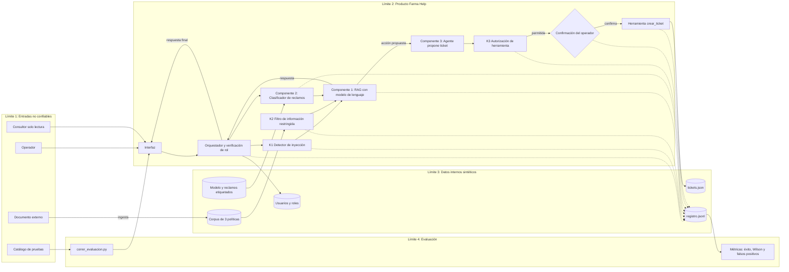

# Farma Help — Arquitectura

## Diagrama

## Componentes

| Componente | Función |
|---|---|
| Interfaz | Recibe la consulta del usuario |
| Orquestador | Verifica el rol y coordina RAG, clasificador, agente y registro |
| RAG | Recupera fragmentos de las políticas y redacta la respuesta citando el documento |
| Clasificador | Asigna el reclamo a entrega, facturación o devolución |
| Agente | Propone un ticket y lo registra solo tras la confirmación del operador |
| K1, K2 y K3 | Controles que se activan o desactivan por parámetro |
| Registro | Guarda consulta, documentos recuperados, acciones y respuestas |

## Límites de confianza

| Límite | Contenido | Por qué importa |
|---|---|---|
| L1 | Usuarios, documentos externos y catálogo de pruebas | Todo lo que entra puede ser malicioso |
| L2 | Producto y controles | Aquí se decide qué llega al modelo y qué acciones se ejecutan |
| L3 | Corpus, modelo, usuarios, tickets y registro | Datos que un atacante querría leer o alterar |
| L4 | Scripts y resultados de evaluación | Mide el efecto de los controles |

Cruces de mayor riesgo:

1. Documento externo hacia el corpus (inyección indirecta).
2. Salida del modelo hacia el agente (se valida en K3).
3. Producto hacia información restringida (filtración).
4. Agente hacia `tickets.json` (ticket no autorizado).

## Estado de implementación

| Elemento | Estado |
|---|---|
| Interfaz, orquestador y RAG | En construcción |
| Clasificador de reclamos | Pendiente |
| Agente y crear_ticket | Pendiente |
| Controles K1, K2 y K3 | Pendiente |
| Registro de eventos | En construcción |
| Evaluación | Pendiente |
